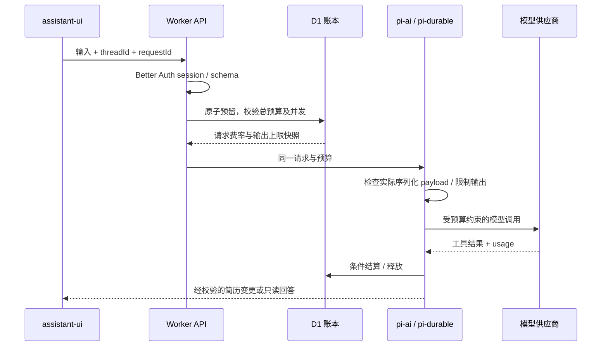

# 计费架构与恢复

更新：2026-11-14。产品费率及一手资料见 [套餐与用量](../product/billing.md)。配置全部由 `.env` 生成；无浏览器余额权威，无客户端套餐写接口。

## 边界

`domain/billing.ts` 定义 Token、套餐和费率 schema，使用 BigInt 乘法并在整轮结算时向上舍入到 microcredit；1 credit = 1,000,000 microcredits。金额使用 USD 整数 cents。`server/billing.ts` 管理 D1 账本及预算，`server/stripe.ts` 封装 Stripe REST、验签和权益同步，`BillingPanel` 只读取服务端摘要。

D1 迁移 `0002_billing.sql` 新增 customer、subscription、run、webhook receipt、同步 lease 和 checkout admission。`billing_runs` 保存 user/thread/request、正文指纹、周期、套餐/费率/输出上限快照、预留及实扣、分类 Token、终态。pi-ai 还缓存最终 AgentResult，以便重复请求返回同一结果，因此 D1 包含这部分简历输出。pi-durable 的最终结果与 transcript 仍由 DO SQLite 保存。完整 UI 对话与简历库仍在本机，没有跨设备同步。

## 预算与幂等

服务端以已验证的 userId + threadId + requestId 的 SHA-256 确定 run，同键不同正文返回 409。预留用单条 `INSERT … SELECT` 同时判断该周期已扣 + 活动预留 + 本轮预留不超过额度、用户活动请求数不超上限；不能通过并发先读余额绕过限制。相同请求只允许一个首次执行者。pi-ai 重复提交有缓存时返回原结果，同一请求仍有预留时返回 409 供稍后查询；账本已结算或释放且无缓存结果时返回 410，允许客户端恢复原文供编辑。

预留按系统、工具、来源和历史的 UTF-8 bytes 估算安全上界，乘以配置的预留系数；若余额不足，降低输出上限，低于最小值则拒绝。真正发送前再次检查最终 payload bytes 的保守费用上界，覆盖普通输入/缓存费率中的最大值及输出上限，必要时在网络前拒绝。bytes 只用于准入，不作为实际用量收费。此保护基于当前文本及函数工具协议；增加多模态内容前必须重新设计预算。

Durable Object 打开 Harness 前应用与 Worker 相同的市场默认配置。生成器会省略等于默认值的绑定，DO 解析模型地址、协议和预算前必须补全这些值。

`pi-models.ts` 在官方 adapter 的 fetch 边界执行检查并写入 `max_output_tokens` / `max_completion_tokens`。不只依赖 durable hook 抛异常，因为 hook 的错误可能被 runtime 报告后继续。两种运行时均只有一轮生成、一个工具，关闭自动重试与 compaction。模型配置与费率模型不一致时关闭 live 调用，避免未知模型按旧价格收费。

结算使用请求创建时的费率快照，`UPDATE … WHERE status='reserved'` 保证重复终态只结算一次。轻量运行在校验工具前捕获供应商 usage；durable 从持久化 assistant messages 合计。工具失败不抹掉已报告用量，reasoning 不额外累加。DO 在 wake、GET、alarm 和显式取消后检查终态，账本故障保留心跳重试；浏览器断开不等于取消。

若实际账单超出预留，返回核对错误并保留预留，绝不静默按预估量扣款。轻量 Worker 在进程崩溃且没有收到 usage 时可能留下预留；D1 预留后但 DO 尚未接收时故障也可能留下预留。没有基于时间直接自动释放的清理器，因为仍在执行的任务会导致超发。运维先检查 DO / provider 与实际终态，再人工核对结算或释放。没有报告的供应商成本由应用承担，不向用户猜测收取。

## 支付与权益

| API                            | 权限与行为                                          |
| ------------------------------ | --------------------------------------------------- |
| GET `/api/billing/`            | session，返回本人摘要，no-store                     |
| POST `/api/billing/checkout`   | session + 同源 Origin，限定 plus/pro，服务端核价    |
| DELETE `/api/billing/checkout` | session + 同源 Origin，查询并关闭待完成结账         |
| POST `/api/billing/portal`     | session + 同源 Origin，使用本人 Stripe customer     |
| POST `/api/billing/webhook`    | 原始正文 HMAC-SHA256 + 时间窗；不依赖浏览器 session |

Checkout 使用稳定 customer 幂等键与每次结账 attempt 幂等键。D1 限制一名用户只有一个待完成结账，不确定创建结果时保留锁；已完成付款的 checkout 不能取消后重新购买。核对 Stripe price 的 USD、月、数量和 $10/$50，不能接受客户端指定 amount 或 customer。

Webhook 接受 invoice.paid、invoice.payment_failed、customer.subscription.updated、customer.subscription.deleted、checkout.session.completed。验签后获取权威最新 subscription 并展开 latest_invoice，验证 metadata 用户与 customer、price 与周期；active 且已付费才授予权益。使用 item 级 `current_period_start/end`，对应固定 API `2025-03-31.basil`。同订阅事件以带 token 的 D1 lease 串行处理，忙时返回重试错误。事件 receipt 与订阅更新在同一批事务中提交；不用 event.created 排序旧快照。旧订阅取消不得覆盖另一份有效新订阅。

回调失败返回 5xx，由 Stripe 重试。固定价格与数量的一人一订阅是首版前提；多订阅、无法识别的价格、所有权异常进入人工对账。退款、拒付、税务与客服操作还没有自动权益策略，正式开放支付前需明确运营处理流程。

## 上游契约参考

- <https://docs.stripe.com/webhooks>：原始正文验签、重试和事件处理。
- <https://docs.stripe.com/changelog/basil/2025-03-31/deprecate-subscription-current-period-start-and-end>：周期字段移至 subscription item。
- <https://docs.stripe.com/api/subscriptions/object>：latest_invoice 可展开为当前账单对象。

## 国内市场支付

`APP_MARKET=cn` 使用独立的 `billing_wechat_orders`，共用原有用量账本与原子预留。用户会话和同源校验覆盖下单及主动查单。D1 部分唯一索引限制每账户一个待支付订单。重试复用原订单参数，付费期内暂停新购。过期订单先查询再关闭，未确认的状态保留以便重试。

回调和查单结果使用微信支付公钥验签，回调验签后用 APIv3 密钥解密。核对支付状态、类型、币种、金额、AppID、商户号及本地订单号后，单条条件更新结算。交易号唯一，重复通知沿用首次结算周期。订单直接提供该账户从微信确认成功时间起 30 天的权益。

## 支付宝网页收款

支付宝额度包沿用人民币 Plus/Pro 定价和 30 天用量周期。D1 的 `billing_alipay_orders` 将套餐、金额、环境、应用和订单号绑定到发起下单时的 Better Auth user ID。已验签的查询或通知校验订单与金额后，用条件更新将同一订单结算一次。微信和支付宝下单均在 D1 写入时检查待支付订单与有效权益。生产订单和沙箱订单按环境隔离。

官方 Node SDK 生成付款表单并验证交易结果和异步通知。Worker 用 Fetch 适配 SDK 的传输边界。同步回跳仅使用订单号定位当前会话拥有的订单并主动查单。生产定时任务补偿未收到通知或用户离开页面留下的待支付订单。全额退款通过同一个固定退款请求号查询确认后回收剩余权益。

国内测试 Pro 授权保存在 `billing_test_grants`，绑定账户和独立有效期，通过受控数据库操作发放。有效付费权益优先；测试权益使用同一额度账本，并在有效期间阻止新购。测试授权无支付订单。
