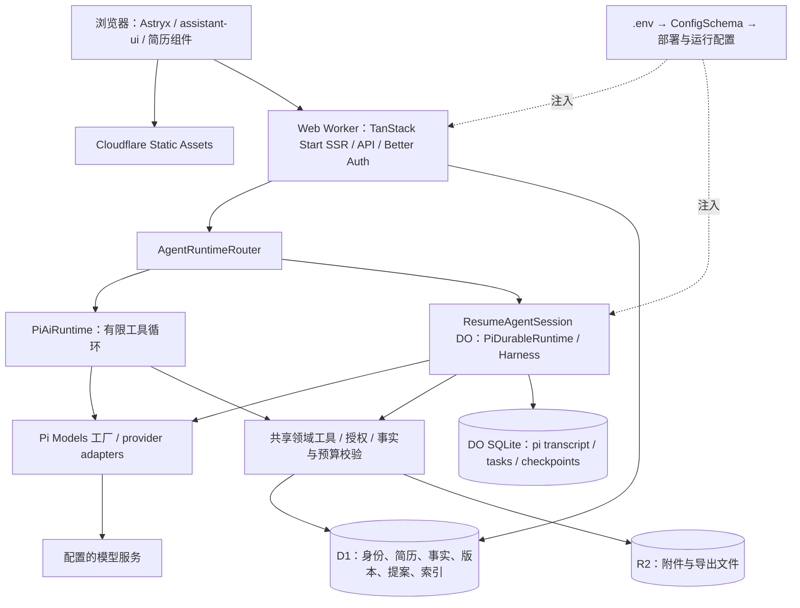
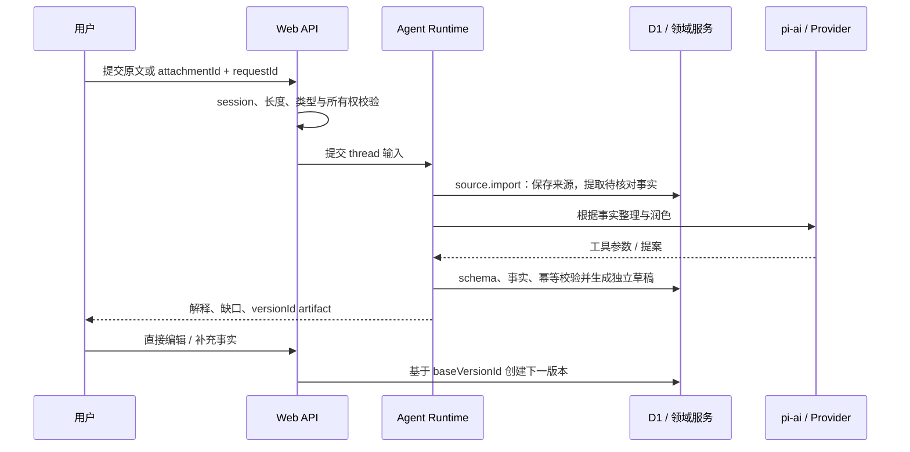
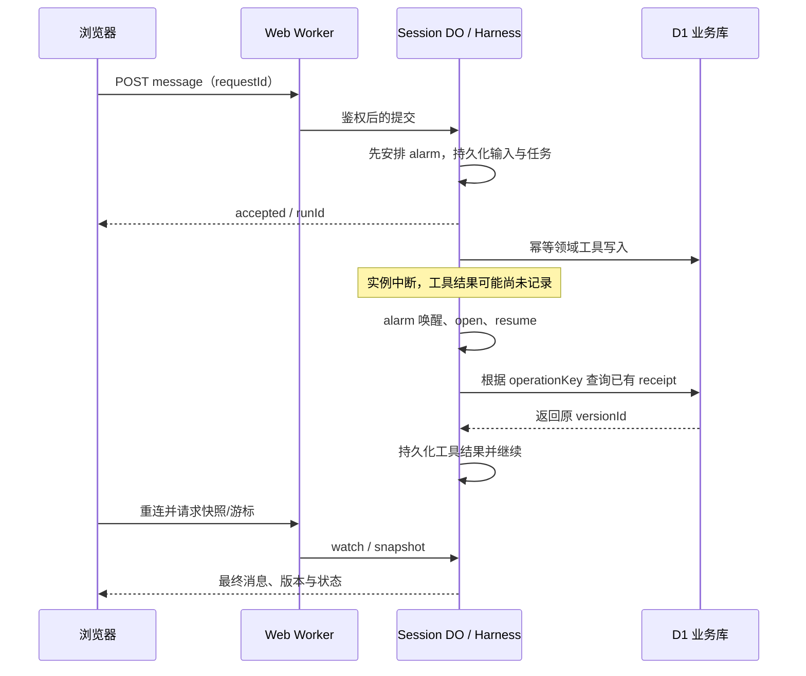

# Folio 技术架构设计

版本：1.1（开发基线与实施边界）  
状态：目标架构分阶段实施；当前 pi 双运行时已接入，云端业务存储待实施  
更新日期：2026-11-14

## 1. 架构决策

Folio 采用 **TanStack Start 全栈应用 + Cloudflare Workers/Static Assets + D1 业务存储 + Cloudflare Durable Objects 持久化 Agent**。前端继续使用 Astryx 与 assistant-ui，简历领域模型和组件保持独立。

模型访问统一使用 `@earendil-works/pi-ai`。Agent 提供两个运行适配器：`pi-ai` 适配器由应用实现有限工具循环，`pi-durable` 适配器使用 `@earendil-works/pi-durable` 的 Harness、会话与任务机制。正式应用默认使用 `pi-durable`，两者共享模型工厂、领域工具、权限、事实约束与前端事件协议。

所有可调整的运行、模型、认证、限额和部署参数，以 **项目根目录 `.env` 为唯一人工配置入口**。配置经过类型校验后分流为 Worker bindings、运行变量、secret 和最小公开配置。Cloudflare 执行时读取注入的配置，不读取磁盘 `.env`。

| 决策         | 采用方案                        | 原因                                                       |
| ------------ | ------------------------------- | ---------------------------------------------------------- |
| UI 基础      | Astryx + React 19               | 延续原型和现有组件体系                                     |
| 对话         | assistant-ui + 服务端事件适配   | 保留聊天体验，服务端管理真实会话                           |
| 应用与构建   | TanStack Start + Vite           | 统一页面、SSR、API 与构建                                  |
| 身份         | Better Auth + Google OAuth + D1 | 服务端 session 确定资源所有者                              |
| 模型访问     | pi-ai                           | 统一 provider、模型、流式输出和工具调用                    |
| Agent 执行   | pi-ai / pi-durable 双适配器     | 兼顾有限请求与可恢复工作流                                 |
| 默认运行模式 | pi-durable                      | 简历编辑需要跨轮状态、断线恢复和事实确认                   |
| 业务数据     | D1                              | 简历、事实、版本、提案与所有权的权威来源                   |
| 持久化执行   | SQLite-backed Durable Object    | 使用 pi-durable 官方 Cloudflare storage adapter            |
| 文件         | R2                              | 原始附件、提取结果与导出产物                               |
| 配置         | `.env` → 校验 → 注入/生成       | 消除 `.dev.vars`、Wrangler vars 与代码默认值的人工重复维护 |

## 2. 现状与目标边界

当前原型已经具备简历预览、直接编辑、规则润色、JD 关键词排序、模板切换、本机存储、认证入口和 Workers 构建。

2026-11-14 部署进展：现有原型参数的 `.env` 校验、Wrangler 配置生成、运行密钥白名单同步，以及 D1/自定义域名生产部署已经完成。pi-ai、pi-durable、共享简历工具、本机对话持久化与章节布局已经实现。下列目标能力仍分阶段落地，不能据此认为云端业务存储、SSE 或完整提案审计已经实现。

本设计需要新增：

- 在已接入的 `.env` 配置流水线上扩展 Agent、预算与文件相关参数。
- 服务端简历库、不可变版本、事实来源、岗位描述、对话和运行记录。
- pi-ai 模型层、两个 Agent 运行适配器及共享领域工具。
- 流式事件、对话恢复、任务取消、预算与调用幂等。
- pi-durable 与 Durable Objects 的启动、恢复、alarm 和升级策略。
- R2 文件管理、浏览器本机数据迁移和测试隔离。

[原型架构](../harness/architecture.md) 描述已实现状态。本文件决定后续开发方向；原型的 `.dev.vars`、手写 Chat Completions 请求和 localStorage 主存储将逐步迁移，不应继续扩展为生产架构。

### 当前落地范围（2026-11-14）

- `src/server/pi-models.ts` 统一 pi models/provider，`AI_API` 选择 `openai-responses` 或 `openai-completions`；当前模型实测需要 Responses + low reasoning，不发送 temperature。
- `resume-agent.ts` 是一次模型请求、一次受校验工具操作的轻量适配器。`durable-harness.ts` 使用原生 Harness / registry / defineTool，相同领域工具完成后 terminate，不执行任意代码或终端工具。
- 当前 DO 粒度是 `(session.userId, threadId, requestId)` 的单轮任务；保存原生 transcript/tasks/tool results，并非下文目标“一条 thread 一个 DO”。请求正文不可变，同 ID 不同输入返回 409。
- 浏览器按身份保存完整对话与 pendingRequest；每次传入最近最多 40 条、合计 32,000 字符历史。durable 返回 202，前端轮询 JSON 快照；刷新复用请求，明确取消单独调用 DELETE。当前没有 SSE/token streaming。
- 简历库及完整 UI 对话仍在 localStorage；D1 已保存认证、计费账本/订阅与 pi-ai 最终结果缓存，见 [计费架构](billing.md)。DO 执行记录不等于跨设备简历/聊天同步，不宣称业务版本审计、完整事实溯源或云端回滚。
- PDF/DOCX 浏览器本地提取与简历语义富文本已经实现，见 [文档导入与富文本](document-import.md)。不依赖目标 R2 文件存储，无附件上传、OCR 或原版式复刻；既有字符串字段承载 Markdown，预览、模板与打印共用渲染器。

## 3. pi 技术核实与版本基线

本次核实 npm 发布的 `@earendil-works/pi-ai@1.5.2`、`@earendil-works/pi-durable@1.5.2` 的元数据、README、exports 和 TypeScript 声明；核对了上游仓库文档。实现时锁定同一发行版本，连同 `@earendil-works/chord`、`@earendil-works/pi-schema` 一起升级和回归。

| 能力            | 已核实的上游接口/行为                                                 | Folio 的使用方式                         |
| --------------- | --------------------------------------------------------------------- | ---------------------------------------- |
| 模型集合        | `createModels()`、`models.setProvider()`                              | 按配置构造模型访问层                     |
| provider        | `providers/<provider>` 子路径工厂                                     | 按需导入，控制 Worker 包体积             |
| 流式访问        | `models.stream()` / `models.streamSimple()`                           | 转为 Folio AgentEvent                    |
| 自定义兼容端点  | `createProvider()` + 对应 API adapter                                 | 为自有网关提供显式配置                   |
| Worker 认证注入 | `createModels({ authContext })`，含 `env()` / `fileExists()`          | 从校验后的 Worker 配置读取 provider 凭据 |
| 持久化 Harness  | `Harness.open(storage, { models, registry, ... }, context)`           | 一条 thread 对应一个 DO 内的 Harness     |
| 提交幂等        | `conversation.submit({ type: 'input', content, requestId }, context)` | 网络重试复用同一 requestId               |
| 恢复            | `harness.resume()`                                                    | DO 初始化与 alarm 后恢复待运行任务       |
| Cloudflare 存储 | `openDurableObjectSqliteStorage(ctx.storage)`                         | 不自行模拟 D1 Storage adapter            |
| 唤醒            | `onWake`、`harness.wake()`、DO alarm                                  | 显式恢复睡眠和实例中断后的工作           |
| 工具            | `defineTool()`、`defineExtension()`、`createRegistry()`               | 注册受限简历工具集                       |
| 工具重放        | 只有声明 `replay: 'safe'` 的工具才可在中断后重跑                      | 先证明幂等，再声明安全                   |
| 会话观察        | `conversation.watch()` / `ConversationTranscript`                     | 生成快照、增量与缺口恢复                 |
| 取消            | `conversation.abort(context)`                                         | 与“停止观看 SSE”分开                     |

pi-ai 是模型访问库，**不会自动提供应用需要的 Agent 工具循环**。轻量适配器需要自行管理模型响应、参数校验、工具执行、结果回填和终止条件。

pi-durable 明确标注 experimental，不能根据旧示例或上游 main 直接假定 API 稳定。例如发布包 1.5.2 的 exports 中没有 `defineSignal`；本设计用应用级提案和后续输入实现用户补充，不依赖 main 中可能新增的 signal API。Node 工具链要求至少满足 pi 包的 `>=22.19.0`，项目统一使用 Node 24。

当前已安装并锁定 pi-ai / pi-durable / pi-schema / chord 1.5.2，完成原生工具调用、SQLite 关闭重开恢复和真实模型双运行时验证。现状见 [当前架构](../harness/architecture.md)；本文件下文保留完整目标设计。

## 4. 总体部署架构



第一阶段采用 **单个 Worker 部署单元**：TanStack Start 的自定义 Worker entry 导出默认请求处理器及 `ResumeAgentSession` Durable Object 类，配置 `AGENT_SESSIONS` binding 与 SQLite class migration。Static Assets 同时发布；D1、R2、DO namespace 以 bindings 注入。

单部署避免额外服务通信与内部 API 密钥。未来如需独立发布 Agent Worker，优先使用 Cloudflare Service Binding，不直接暴露 DO 调用入口。

每个 DO 对应 `(tenantId, threadId)`，由服务端计算 namespace key，初始化时持久化并检查身份。threadId 只用于寻址，不能代替资源授权。浏览器只访问经过 session 校验的 Web API。

## 5. 模块分层与源码布局

```text
src/
  app/                         工作台、视图与页面编排
  components/
    chat/                      assistant-ui primitives、工具卡片和状态
    resume/                    文档、section、模板、编辑与差异组件
  domain/
    resume/                    Resume、Section、Fact、Version、Proposal
    job/                       JD、Requirement、EvidenceMatch
    agent/                     Run 状态、事件和工具契约
  config/
    schema.ts                  .env 完整 schema 与校验规则
    server.ts                  Worker bindings → ServerConfig
    public.ts                  明确白名单的 PublicConfig
  server/
    auth/                      Better Auth 与权限上下文
    repositories/              D1/R2 访问，强制 tenant scope
    services/                  简历、版本、提案、文件业务服务
    agent/
      runtime.ts               应用自己的 AgentRuntime interface
      router.ts                根据 thread 的 runtime 选适配器
      models/                  pi 模型工厂、provider 和凭据映射
      runtimes/pi-ai/          有限工具循环
      runtimes/pi-durable/     Harness、registry 与对话投影
      tools/                   共享工具定义与领域执行器
      policies/                事实、权限、预算与上下文策略
      transport/               SSE、快照、重连和 assistant-ui 映射
      durable-objects/          ResumeAgentSession 生命周期与 alarm
  routes/                      TanStack 页面与服务端路由
scripts/
  config/                      校验 .env、生成 Wrangler 配置
  deploy/                      生成发布计划、同步 secret、部署
migrations/                    D1 业务迁移
```

这是目标布局，不要求一次性移动所有原型文件。按领域切分新增模块，沿用已有可复用组件；先稳定契约，再替换实现。

依赖方向：UI → 应用协议 → 领域服务；runtime → 共享工具 → 领域服务 → repository。领域模型不导入 pi、assistant-ui 或 Cloudflare。provider 凭据、系统提示与工具实现不能进入客户端 bundle。

## 6. `.env` 唯一配置入口

### 6.1 配置流

```text
根 .env
  ├─ ConfigSchema：解析、校验、交叉校验
  ├─ ServerConfig：运行模式、模型、OAuth、预算
  ├─ DeployConfig：账户、Worker、D1/R2 资源与兼容日期
  ├─ PublicConfig：应用名称、公开模式、功能可用状态
  ├─ 生成 Wrangler 配置：资源 binding + 非敏感 vars
  └─ 部署 secret 载荷：敏感字段白名单 → Worker Secrets
```

所有参数由 `.env` 设置，应用不另设一套与之竞争的人工默认值。`.env.example` 维护字段清单与建议值；正式运行缺少必填项立即失败，不静默切换到 demo 或其他模型。

开发命令显式解析根 `.env`；不依赖 Vite 的 `VITE_*` 前缀泄露配置，不把 `loadEnv(..., '')` 的结果批量写入 `define`。禁止并行维护 `.dev.vars`、`.env.local`、`.env.production` 或手工 Wrangler vars。开发启动检查冲突文件并给出迁移提示。CI 在受控环境挂载对应环境的一份 `.env`，然后运行同一条配置流水线。

Cloudflare Worker 不能通过读取本地文件获得生产配置。部署脚本把 `.env` 中选定字段同步为非敏感 vars 与 Secrets，并生成 D1/R2/DO bindings；运行时用 typed binding 还原配置。平台注入是执行载体，`.env` 仍是参数来源。Workers 中的 DB/R2/DO 对象是平台能力，不是可以写进 dotenv 的字符串。

应用源码保留 binding 名、类名、迁移历史、schema、提示模板和工具名称等程序契约；它们不属于按环境调整的参数。用户简历、任务输入和界面偏好属于业务数据，存数据库，不写 `.env`。

### 6.2 建议字段

以下是目标字段清单。空值为尚待部署者提供的内容，不代表可直接用于生产。

```dotenv
# 应用
APP_ENV=development
APP_NAME=Folio
APP_ORIGIN=http://localhost:5173
APP_MODE=demo
DEV_PORT=5173
LOG_LEVEL=info

# Better Auth；baseURL 由 APP_ORIGIN 派生，不另维护第二份地址
BETTER_AUTH_SECRET=
GOOGLE_CLIENT_ID=
GOOGLE_CLIENT_SECRET=

# 运行时；pi-durable 为正式应用默认
AGENT_RUNTIME=pi-durable
AGENT_MODEL_PROVIDER=openai
AGENT_MODEL_ID=
AGENT_PROVIDER_API_KEY=
# 仅 custom provider 需要；内置 provider 使用其原生端点
AGENT_PROVIDER_BASE_URL=
AGENT_MODEL_API=openai-responses
AGENT_CUSTOM_CONTEXT_WINDOW=128000
AGENT_CUSTOM_MAX_OUTPUT_TOKENS=4096
AGENT_PROMPT_VERSION=resume-v1
AGENT_TOOLSET_VERSION=resume-v1
AGENT_MAX_TURNS=8
AGENT_MAX_TOOL_CALLS=24
AGENT_MAX_OUTPUT_TOKENS=4096
AGENT_REQUEST_TIMEOUT_MS=45000
AGENT_RUN_DEADLINE_MS=180000
AGENT_MAX_INPUT_CHARS=20000
AGENT_MAX_CONTEXT_TOKENS=24000
AGENT_MAX_DAILY_TOKENS_PER_USER=200000
AGENT_MAX_ACTIVE_RUNS_PER_USER=2
AGENT_MODEL_RETRY_LIMIT=2
AGENT_RESTART_LIMIT=3
AGENT_RECOVERY_HEARTBEAT_MS=60000
AGENT_EVENT_RETENTION_HOURS=24
AGENT_FACT_RETRIEVAL_LIMIT=20

# HTTP、存储与文件策略
HTTP_MAX_BODY_BYTES=262144
SSE_HEARTBEAT_MS=15000
UPLOAD_MAX_BYTES=10485760
UPLOAD_ALLOWED_TYPES=text/plain,text/markdown,application/json
UPLOAD_RETENTION_DAYS=30
EXPORT_RETENTION_DAYS=7
PUBLIC_TEMPLATE_IDS=editorial,minimal,professional,technical

# 部署与资源
CLOUDFLARE_ACCOUNT_ID=
CLOUDFLARE_API_TOKEN=
CLOUDFLARE_WORKER_NAME=folio-resume-agent
CLOUDFLARE_COMPATIBILITY_DATE=2026-11-14
CLOUDFLARE_D1_DATABASE_NAME=folio
CLOUDFLARE_D1_DATABASE_ID=
CLOUDFLARE_R2_BUCKET_NAME=folio-files
CLOUDFLARE_OBSERVABILITY_ENABLED=true
```

不以该示例中的数值承诺服务容量；它们是首轮实现和压测的初始配置。`AGENT_MODEL_ID` 必须来自实际 provider 可用目录；自定义模型的窗口和输出上限必须和服务端能力一致。额外 provider 需要新增明确 schema 字段与适配器，不允许前端上传任意 URL 或密钥。

### 6.3 校验与分流规则

- `APP_MODE=demo` 可不配置模型与 Google 凭据，但模式明确可见。
- `APP_MODE=live` 要求有效 origin、认证 secret、Google 凭据和模型配置；正式应用不能公开匿名付费模型接口。
- `AGENT_RUNTIME` 只允许 `pi-ai | pi-durable`。模型 provider、API、modelId 的组合不支持时启动失败。
- 内置 provider 从 `AGENT_PROVIDER_API_KEY` 映射到其所需的 authContext 环境名；不依赖 Worker 恰好支持 `process.env`。
- 自定义端点必须由 `.env` 配置并在启动时校验协议/主机。provider 与 API 协议明确关联，不对所有模型强行发送 Chat Completions。
- secret 白名单：Better Auth secret、Google client secret、模型 API key；Google client ID 也可按受限配置统一分发。
- `CLOUDFLARE_API_TOKEN` 仅供部署进程使用，绝不注入应用 Worker 或客户端。
- 公开配置只返回 UI 实际需要的白名单字段，不输出完整 ServerConfig。
- `.env`、临时 secret 载荷、生成配置目录、构建状态都忽略提交。日志只列缺失字段和脱敏变更，不打印字段值。
- 发布计划校验 `.env` 与生成产物摘要一致；修改参数后重新构建/发布，避免旧 vars 配合新 Secrets。

目标命令为 `config:check`、`dev`、`build`、`deploy:plan`、`deploy:apply`。这些脚本尚未实现。`deploy:plan` 只显示脱敏差异；`deploy:apply` 读取同一份校验配置执行发布，实际部署动作按用户指定环境进行。

## 7. Agent 双运行适配器

### 7.1 统一应用协议

下面是 **Folio 自定义契约**，不是 pi 导出的接口：

```ts
type AgentRuntimeKind = 'pi-ai' | 'pi-durable'

type AgentCommand = {
  threadId: string
  clientMessageId: string
  requestId: string
  content: string
  attachmentIds: string[]
  selectedResumeId?: string
  selectedVersionId?: string
}

type AgentScope = {
  tenantId: string
  userId: string
  traceId: string
}

type RunAdmission =
  | {
      mode: 'transient'
      receipt: RunReceipt
      events: AsyncIterable<AgentEvent>
    }
  | {
      mode: 'durable'
      receipt: RunReceipt
    }

interface AgentRuntime {
  submit(scope: AgentScope, command: AgentCommand): Promise<RunAdmission>
  snapshot(scope: AgentScope, threadId: string): Promise<ThreadSnapshot>
  watch(
    scope: AgentScope,
    threadId: string,
    cursor?: string,
  ): AsyncIterable<AgentEvent>
  cancel(
    scope: AgentScope,
    threadId: string,
    runId: string,
  ): Promise<RunReceipt>
}
```

`AgentScope` 由服务端认证生成，不接受客户端覆盖。`RunReceipt`、`ThreadSnapshot`、`AgentEvent` 在实现前定义 Zod schema。每个 thread 创建时固定 runtime、模型、prompt/toolset 版本和预算快照；`.env` 控制新 thread 的默认策略与全局上限。既有 thread 不因为全局模式改变而丢失恢复路径。

`RunAdmission` 的 transient 分支只用于同一 Worker 请求内，HTTP 层将 events 转为 POST 响应的 SSE；不能把 AsyncIterable 当作 JSON 返回。durable 分支返回 202 receipt，再独立 watch。轻量模式的独立 watch 仅提供已落盘状态和结果，不承诺重连正在执行的 token 流。界面根据能力显示可用操作。

配置快照只保存非敏感策略、模型引用和版本号，不包含 API key、OAuth secret 或完整 `.env`。恢复后仍通过宿主配置解析凭据，避免 secret 进入 pi transcript、D1 或事件。

切换默认 runtime 只影响新 thread。原 thread 迁移需显式导出规范化上下文并建立新 thread，不能将两种内部存储直接混用。

### 7.2 PiAiRuntime

执行流程：从 D1 恢复该 thread 的历史 → 构造 pi-ai Context → 流式模型响应 → 验证工具参数 → 调用共享工具 → 回填 toolResult → 下一轮，直到完成、预算耗尽、取消或需要用户补充。

- D1 保存输入、最终消息、工具结果和运行状态，能在刷新后查看历史。
- 同一 thread 通过有期限的 D1 lease + fencing token 阻止并发写；所有写入验证当前 fence，不能只靠进程内 Map。
- 执行发生在当前请求流生命周期内。连接中断或 Worker 结束时尝试取消；逾期 lease 释放后将旧 run 标记为 interrupted。
- 历史持久化不等于执行可恢复。轻量模式不承诺从工具中间断点自动续跑；用户重试必须走幂等记录。
- 不以 `waitUntil()` 充当无限期任务执行器。需要离线继续、睡眠或可靠恢复时，创建 pi-durable thread。
- 达到 turns/tools/tokens/deadline 上限时返回明确终态，不再让模型继续规划。

### 7.3 PiDurableRuntime

每条 thread 的 DO 通过 `Harness.open()` 打开 SQLite storage，安装版本匹配的模型、registry 和领域工具，获取 root conversation。DO 是该 storage 的唯一写者。

用户输入使用稳定 requestId 调用 `submit()`；提交持久化后返回 run receipt。HTTP 请求不等待整个 Agent 完成。客户端通过独立 SSE 订阅状态，刷新后重新获取快照。

恢复语义：

1. 初始化先设置兜底 alarm，再打开 storage/Harness，避免打开失败后没有下一次唤醒。
2. 按 `harness.wake()` 安排最早 sleep deadline；运行期间保留 recovery heartbeat。
3. `submit`、`abort`、registry/configure 等可能启动工作的操作，在调用前先确保 alarm 已安排。
4. `onWake` 更新 alarm；alarm handler 重新读取 wake 状态并调用 `resume()`。
5. 没有 active work 和 sleep deadline 才删除 alarm。不要在每次 HTTP 返回时 close Harness。
6. storage 错误按上游语义视为 Harness 失败，停止发布“成功”事件，并通过实例重建恢复；不盲目重跑业务写入。

DO 实例存活、HTTP 连接存活、Harness 持久化是三个概念。持久化本身不会自动唤醒被回收的实例；alarm 是本系统恢复链路的一部分。也不能假定 DO 在存在异步 I/O 时绝无请求交错，registry 初始化和应用写入仍需使用其队列与事务语义。

等待用户补充时，保存 `awaiting_input` 提案状态并结束当前生成。用户下一条输入或确认命令推进后续流程；不保留跨实例的 JS Promise，也不使用未核实的 signal API。

### 7.4 模型工厂与打包

使用 `@earendil-works/pi-ai/models`、选定的 provider 子路径和必要的 API adapter。避免 `providers/all`、Node 文件系统、coding-agent CLI、bash、进程执行和 Node-only provider 被引入 Worker。

`createModels({ authContext })` 注入从 ServerConfig 派生的凭据读取函数，`fileExists` 在 Workers 中明确返回 false。内部 provider OAuth 登录不属于本产品用户认证；Google OAuth 始终由 Better Auth 处理。

首轮只注册经 Worker 集成验证的少量 provider。pi-durable 的 Node 环境、图像处理和 code mode 扩展不默认启用。模型只调用受控简历工具，不获得执行任意 JavaScript/命令的能力。其他 provider 和 sandbox 的支持需要独立验收。

## 8. 简历领域与核心组件

### 8.1 数据对象

| 对象             | 关键字段                                                            | 作用                                          |
| ---------------- | ------------------------------------------------------------------- | --------------------------------------------- |
| CandidateProfile | tenantId、id、identity                                              | 一位候选人的简历归属，替代姓名/邮箱字符串推断 |
| Resume           | candidateId、id、title、headVersionId                               | 一份基础或定制简历的稳定入口                  |
| ResumeVersion    | id、resumeId、parentVersionId、document、schemaVersion、contentHash | 不可变内容快照                                |
| ResumeFact       | candidateId、id、kind、value、sourceId、sourceSpan、verification    | 可引用的真实经历/技能/教育事实                |
| SourceDocument   | id、candidateId、r2Key、mimeType、extractionVersion                 | 原始文本或附件及提取记录                      |
| JobDescription   | id、rawText、requirements、contentHash                              | 原始 JD 与结构化岗位要求                      |
| ResumeProposal   | baseVersionId、patch、evidenceRefs、missing、status                 | 可核对改写与事实缺口                          |
| ResumeTemplate   | id、version、capabilities                                           | 版式能力，不承载候选人事实                    |

身份隔离由 tenantId 与 candidateId 决定。禁止继续依赖“同名且邮箱相近”的启发式作为生产授权或候选人归属。

### 8.2 文档组件契约

`ResumeDocument` 继续作为预览与打印的唯一渲染器，消费版本化 ResumeDocument 数据。模板只决定布局，不修改事实。新增：

- `ResumeSection` / `ExperienceBlock` / `EducationBlock` / `SkillList`：可组合的领域块。
- `ResumeCanvas`：版本选择、预览状态和模板装配。
- `ResumeEditor`：字段编辑转换为 patch，经服务端校验后生成新版本。
- `ResumeDiff`：展示当前版本与提案的差异、来源和缺口。
- `JobMatchPanel`：呈现要求与证据，不将覆盖率伪装成招聘成功率。
- `ResumeArtifactCard`：聊天消息中链接具体 resumeId/versionId，点击打开对应画布。

React 不直接执行模型产出的 HTML/JSX。长文档分页、无经历、英文长词和导出均使用同一事实数据进行回归。

### 8.3 版本策略

所有生产编辑和生成都创建不可变版本，替换原型的“直接覆盖当前快照”。基础简历与定制简历通过 resumeId 区分，通过 parent/source version 建立来源关系。

Agent 可自动创建独立草稿并加入简历库，让聊天与画布即时联动。只有将提案应用到已有主版本、删除数据或执行外部动作时，才需要相应明确用户指令或 UI 动作；不对每次润色增加多余确认。

应用版本时携带 `baseVersionId`。若用户已在其他标签页编辑，返回 409 和最新 head，保留提案，不覆盖新内容。正式 PDF/JSON 导出引用 versionId，避免导出过程中内容漂移。

## 9. Agent 领域工具与事实治理

两个 runtime 调用同一组业务执行器。工具参数使用标准 JSON Schema；pi 工具层按其约定校验，领域服务继续用 Zod/业务规则校验。schema 从一个权威定义生成，不能维护两套含义不同的规则。

| 工具                        | 作用                                   | 写入策略                     |
| --------------------------- | -------------------------------------- | ---------------------------- |
| resume.read                 | 读取授权版本与必要事实                 | 只读                         |
| resume.search               | 依据 JD 在当前 candidate 的事实库检索  | 只读，返回 factId 与来源     |
| source.import               | 提取原文并生成待核对事实               | 幂等入库；不直接确认事实     |
| job.analyze                 | 保存/解析 JD 要求                      | 按 contentHash 和请求去重    |
| resume.propose              | 生成有来源的改写提案                   | 保存 proposal；不得覆盖主档  |
| resume.createDraft          | 将验证通过的提案生成独立草稿           | 自动允许，按 proposalId 幂等 |
| resume.preview              | 返回 versionId / templateId / artifact | 不生成可执行 HTML            |
| resume.requestClarification | 记录需要补充的问题                     | 保存待补充状态并结束当前轮   |

`resume.applyProposal`、删除与正式导出由应用服务执行，模型不能仅凭提示自行获得权限。确有必要将其暴露给工具时，必须校验服务端签发的具体动作授权与 baseVersionId。

事实规则：

1. JD 只能提供要求，不能成为候选人已具备资格的来源。
2. 每个新增经历、技能、教育和量化数据都需要 factId/sourceSpan；改写保留对应来源。
3. 用户新提供的信息先记录为 user_provided；“用户提供”与“外部验证”明确区分。
4. 无依据的资格放入 missing；冲突字段提出问题，不擅自选择更漂亮的版本。
5. 结构校验、数字/实体一致性与来源覆盖检查联合执行；对语义真实性不能自动证明的内容明确提示核对。
6. 会话摘要、模型思考和前次生成文字不能自动升级为新的事实来源。

上下文由“系统规则 + 当前目标 + 授权版本 + 检索出的事实 + JD + 必要对话历史/摘要”构成。原始文件和历史全量简历不直接堆进每次请求。上下文预算、检索数量和输出预算由配置控制。

## 10. 数据存储与一致性

### 10.1 权威来源

| 数据                                            | 权威存储               | 说明                       |
| ----------------------------------------------- | ---------------------- | -------------------------- |
| 用户、session、OAuth account                    | D1                     | Better Auth 管理           |
| candidate、简历、事实、版本、JD、提案           | D1                     | 生产主数据                 |
| thread 元数据、runtime 归属、运行索引           | D1                     | 用于授权、列表和恢复寻址   |
| pi-ai thread 消息与最终工具结果                 | D1                     | 轻量模式的历史来源         |
| pi-durable transcript、tasks、checkpoints、用量 | DO SQLite / pi storage | 持久化执行的权威来源       |
| durable thread 的列表摘要/状态                  | D1 投影                | 允许短暂延迟，可重建       |
| 附件与导出对象                                  | R2                     | D1 保存元数据和所有权      |
| UI 输入与未提交编辑                             | 浏览器                 | 仅缓存，不作为云端权威数据 |

pi-durable 的内部表由 pi 管理，不复制到 D1 再声称有两个主存储。D1 不充当 DO SQLite 的替代连接，也不在一次操作中假定跨 DO/D1/R2 的全局事务。

### 10.2 业务表建议

```text
candidate_profiles(id, tenant_id, identity_json, created_at)
resumes(id, tenant_id, candidate_id, head_version_id, label, kind)
resume_versions(id, tenant_id, resume_id, parent_version_id, content_json,
                schema_version, content_hash, proposal_id, created_at)
source_documents(id, tenant_id, candidate_id, r2_key, content_hash, status)
resume_facts(id, tenant_id, candidate_id, source_id, source_span, value_json, verification)
job_descriptions(id, tenant_id, raw_text, requirements_json, content_hash)
resume_proposals(id, tenant_id, base_version_id, job_id, patch_json,
                 evidence_json, missing_json, status)
threads(id, tenant_id, candidate_id, runtime, runtime_version, model_ref, config_snapshot)
thread_messages(id, tenant_id, thread_id, role, content_json, seq)  # pi-ai 权威历史
agent_runs(id, tenant_id, thread_id, request_id, status, runtime_ref, fence, expires_at)
operation_receipts(tenant_id, operation_key, result_ref, result_hash, created_at)
artifacts(id, tenant_id, version_id, r2_key, status, expires_at)
```

字段是逻辑模型，不是可直接执行的 SQL。实现时补充联合唯一键、外键、tenant 索引、软删除/数据删除策略和向前迁移。

### 10.3 幂等与跨存储恢复

入口以 `(tenantId, threadId, requestId)` 去重，同时记录正文 hash；相同键不同正文返回 409。pi-durable 的 `requestId` 幂等解决输入重复，不代表外部工具副作用 exactly-once。

业务写入使用稳定 operationKey。独立草稿以 proposalId 保证同一提案不会重复创建版本；重复的工具调用读取 operation receipt 并返回同一业务结果。

关键故障窗口：D1 已提交版本，但 DO 尚未提交工具结果时进程中断。重放工具必须查询 D1 receipt，恢复已生成的 versionId，不能再创建一份版本。只有满足此条件才将工具标记为 `replay: 'safe'`。

版本写入、head 条件更新、receipt 在同一 D1 原子批次内完成。`UPDATE ... WHERE head_version_id = ?` 命中 0 行不是 SQL 错误；实现必须用数据库约束/触发器等方式保证冲突时整批不提交，并在 D1 集成测试中证明，不能仅检查更新条数后留下孤立副作用。

R2 对象先以 staging key 上传，再由 D1 元数据发布；数据库失败留下的对象由清理任务回收。创建导出任务和对象重试均使用稳定 artifactId。

## 11. API、事件与 assistant-ui

### 11.1 API 目标

| 接口                                     | 用途                                  |
| ---------------------------------------- | ------------------------------------- |
| GET/POST /api/auth/$                     | Better Auth                           |
| GET /api/config                          | 最小公开配置与能力状态                |
| GET/POST /api/resumes                    | 列表、创建基础简历                    |
| GET /api/resumes/:id/versions            | 版本历史                              |
| POST /api/resumes/:id/versions           | 手工编辑保存，校验 baseVersionId      |
| POST /api/sources                        | 原文/附件导入入口                     |
| POST /api/jobs                           | 保存和解析 JD                         |
| POST /api/threads                        | 固定 runtime 与 candidate 上下文      |
| GET /api/threads/:id                     | 会话、消息窗口、运行与 artifact 快照  |
| POST /api/threads/:id/messages           | 提交，返回 requestId/runId 和订阅信息 |
| GET /api/threads/:id/events              | SSE 订阅，支持游标或快照恢复          |
| POST /api/threads/:id/runs/:runId/cancel | 服务端取消                            |
| POST /api/proposals/:id/apply            | 应用提案，校验权限、授权与基准版本    |
| POST /api/versions/:id/export            | 导出不可变版本                        |

轻量模式的提交响应为 SSE，保持当前模型执行所需的流生命周期；持久化模式在输入 durable admission 后即可返回 202 JSON，随后订阅 GET events。GET events 对轻量模式只提供已落盘状态和结果；token 流仍属于原 POST 请求。客户端适配器屏蔽传输差异，并明确展示两种模式不同的断线行为。

所有业务接口按 session 验证所有权；SSE、下载和取消也鉴权。模型参数中的 tenantId、userId 不参与授权。

### 11.2 稳定事件协议

```ts
type AgentEvent = {
  version: 1
  threadId: string
  runId: string
  eventId: string
  cursor: string
  type:
    | 'run.accepted'
    | 'message.delta'
    | 'message.completed'
    | 'tool.started'
    | 'tool.completed'
    | 'resume.draft.created'
    | 'proposal.created'
    | 'clarification.requested'
    | 'usage.updated'
    | 'run.completed'
    | 'run.cancelled'
    | 'run.failed'
  payload: unknown
}
```

payload 用按 type 区分的 schema 校验。runtime 将 pi-ai 流式事件或 pi-durable conversation view 归一化；前端不绑定 pi 内部 JSON、Chord ops 或实验性事件接口。

- 消息、工具、artifact 使用稳定 ID 去重。客户端重连先合并快照，再接后续事件，不重复插入用户消息。
- durable 的游标对应已持久化 transcript/view 位置，断线后通过 entries 窗口与快照补齐。游标过期返回重同步指令；不伪造未经落盘 token 的逐字重放。
- `pi.live` 的部分进度可能使用 deferred persistence。它可作为暂态 UI，最终消息、业务版本和成功终态必须以持久化事实为准；严禁从暂态进度派生不可撤销写入。
- 首版保证最终消息、工具结果、草稿可恢复，不要求每个 token 都可重放。完整事件日志若后续加入，必须明确同一存储事务或可重建投影规则。
- SSE 断开仅停止订阅。durable 任务继续到完成或预算终止；用户“停止生成”必须调用 cancel API，再观察确认终态。
- 不向浏览器发送原始思考内容、密钥、系统提示或完整未授权事实库。

assistant-ui 管理 composer 和消息呈现；应用 adapter 负责 server thread 身份、提交、快照恢复、事件订阅和取消。只保留一份规范化消息状态，避免 UI 乐观消息与服务端历史形成两个消息源。

## 12. 关键业务流程

### 12.1 导入与润色



原文解析失败不填示例身份；缺少教育/成果时允许空字段并提出针对性问题。没有量化依据时不能为了“润色”编造数字。

### 12.2 按 JD 定制

保存 JD 原文与结构化要求 → 在已授权 candidate 的事实库召回 → 选择并引用多个事实片段 → 生成可追溯提案 → 检测遗漏与事实冲突 → 创建独立定制简历 → 用户核对/编辑 → 按固定 versionId 导出。

先使用 D1 结构化过滤和全文检索能力建立可解释基线；是否引入向量检索由真实召回评估决定，首版不额外引入向量数据库。JD 中的“要求 5 年”只能成为要求，不能自动改写候选人年限。

### 12.3 durable 中断恢复



不承诺 provider 请求只计费一次。中断时外部模型请求可能已经执行但结果未落盘，恢复后的重试计入预算，并受 restart/retry 限制。

## 13. 权限、配额与取消

单用户工作空间初期令 tenantId 与用户空间绑定，仍保留 tenant 字段以便扩展。repository 的方法必须显式接收 scope；文件 key、DO key、版本查询和导出都检查归属。

同源写请求校验 origin/CSRF，cookie 与 session 按 Better Auth 默认安全语义运行。R2 下载使用鉴权代理或短期授权链接，不暴露永久公共简历 URL。

预算在服务端执行：输入 bytes/字符、每轮模型时限、run deadline、turn/tool 上限、上下文/输出 token、用户并发与日用量。跨 DO 的用户并发和用量预留使用 D1 原子配额记录，完成后按实际消耗结算，过期预留可回收。仅在单 thread 内计数不足以防止并发绕过。

取消流程为 `cancel_requested → runtime abort → 持久化终态`。客户端断开不等于 durable abort；取消也不回滚已经完成的独立草稿或外部已计费请求。尚未应用的提案保持可核对，已提交的版本通过新版本撤回，而不是擦除历史。

重试只针对明确可重试的传输失败和限流。schema 错误最多进行受预算约束的修复；权限、事实违规和冲突不自动重试。所有时间等待、重试与恢复必须服从原 run 的绝对 deadline，不能通过重开实例刷新预算。

## 14. 观测、升级与运维

运行记录包含 traceId、threadId、runId、requestId、runtime、模型引用、prompt/toolset 版本、工具名、延迟、重试、token 与状态。关联 pi 遥测而不直接输出简历正文、OAuth token、API key 或工具完整参数。

真实费用只有在模型价格元数据可信时才展示；custom provider 没有价格数据时显示“未知”，不以默认零值宣称免费。

pi 版本、应用事件协议、领域 schema、prompt、工具定义、D1 schema 和 DO class migration 分别版本化。发布前检查未完成任务所需的工具名称与 task version 是否仍可解析；不通过删除旧任务定义强行升级。退回旧代码也不意味着可以读取新 storage 格式，pi-durable 升级需要专门恢复测试。

账户删除需停止其所有活动运行，清理 D1 主数据、R2 对象和对应 DO storage。会话快照与工具日志也包含个人信息，不能只删除简历表。清理依据持久化资源索引执行并可幂等重试。

## 15. 开发顺序与验收

| 阶段            | 工作                                                  | 完成标准                                                                              |
| --------------- | ----------------------------------------------------- | ------------------------------------------------------------------------------------- |
| A：配置与兼容性 | `.env` schema、生成配置、pi 锁版、最小 Worker/DO 验证 | Node 24 构建通过；敏感值不进入 assets；两个 runtime 在本地 Worker 可调用选定 provider |
| B：领域与存储   | D1 简历/事实/版本/提案、repository、R2 来源           | 所有权、并发版本冲突、幂等写入和原文溯源测试通过                                      |
| C：真实 Agent   | pi-ai loop、pi-durable registry、共享工具与预算       | 导入/润色/JD 三条链路都生成有事实来源的独立草稿                                       |
| D：会话与恢复   | SSE、assistant-ui adapter、DO alarm、取消与恢复       | 刷新恢复；重复提交去重；实例重建后续跑；显式取消生效                                  |
| E：迁移与交付   | 本机数据导入、OAuth 实测、导出、staging               | 用户确认导入本机数据；跨账户隔离；真实 Google 往返；固定版本导出                      |

必须覆盖的故障测试：

- 同一 requestId 重试、同键不同内容、同一提案重复创建草稿。
- D1 完成后 DO 工具结果提交前中断，恢复不重复创建版本。
- 多标签页同时编辑，同 thread 多请求、多 thread 抢占用户配额。
- SSE 断开、游标过期、快照与增量重叠、用户重复点击发送。
- DO 打开失败、alarm 写入失败、sleep 截止、重启循环和 storage failure。
- provider 超时/限流/不支持工具、无效参数、事实缺口与提示注入。
- 登录切换、越权 thread/artifact/版本读取、删除账户时仍有活动任务。
- 两种 runtime 使用同一工具 fixture，权限与事实结果保持一致。

文档阶段只执行格式和引用检查；实现阶段再运行类型、领域、Worker 集成、浏览器及恢复测试。已有原型测试继续作为 UI 回归基线，不替代新服务端和故障测试。

## 16. 待实测项与资料

已确定技术方向，实施前需通过最小集成验证的事项：pi 指定 provider 在 Workers 中的导入/流式行为、DO 同部署入口导出、真实 API key 的 authContext 注入、alarm 生命周期、D1 工具幂等及生产包体积。若某 provider 不兼容，报告具体限制并选择已授权范围内的 adapter，不静默切换模型或运行时。

一手资料：

- [pi 仓库](https://github.com/earendil-works/pi)
- [pi-ai 发布包 1.5.2 元数据](https://registry.npmjs.org/@earendil-works/pi-ai/1.5.2)
- [pi-durable 发布包 1.5.2 元数据](https://registry.npmjs.org/@earendil-works/pi-durable/1.5.2)
- [pi-ai README](https://github.com/earendil-works/pi/blob/main/packages/ai/README.md)：Models、provider、authContext、工具与打包。
- [pi-durable README](https://github.com/earendil-works/pi/blob/main/packages/durable/README.md)：Harness、storage、Cloudflare alarm、watch、abort、replay。
- [Cloudflare 环境变量与本地 secret](https://developers.cloudflare.com/workers/development-testing/environment-variables/)
- [Cloudflare Workers SDK](https://github.com/cloudflare/workers-sdk)：Vite dotenv 加载、Wrangler env-file 和 secret bulk 行为。
- [Cloudflare Durable Objects SQLite](https://developers.cloudflare.com/durable-objects/api/sqlite-storage-api/)
- [Cloudflare Durable Objects alarms](https://developers.cloudflare.com/durable-objects/api/alarms/)
- [TanStack Start Cloudflare 部署](https://tanstack.com/start/latest/docs/framework/react/guide/hosting)

上游 main 可能领先于 npm 发布包。实现契约以锁定包的 exports、类型、测试和实际 Worker 验证为准；本文中的 Folio 接口、数据表与环境字段是本项目设计，不宣称为上游现成功能。
