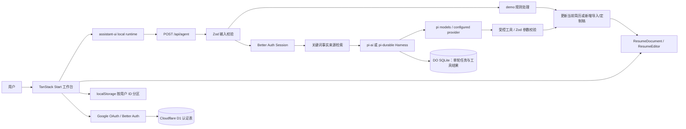

# 系统架构

本文记录当前已实现结构。完整目标设计见 [技术架构设计](../architecture/technical-architecture.md)。`.env` 配置、pi-ai / pi-durable 双运行时与共享工具已接入；云端简历及完整对话同步仍待实现。

## 当前结构

Worker 承载 SSR 与 API；Static Assets 提供浏览器 JS/CSS；D1 存 user、session、account、verification。当前简历与完整 UI 对话保存在浏览器，不写 D1。pi-durable 另在 DO SQLite 保存每轮输入、transcript、tasks 和工具结果。演示请求不在服务端保存。真实模型只在 Worker 读取密钥。

首页的 Entry 统一加载公开配置与 Better Auth session，再选择 LandingPage 或 Workspace。工作台按身份 key 挂载，退出后卸载；落地页不初始化简历数据。demo 只有明确点击试用才打开 guest 工作台；live 不提供绕过登录的访客工作台。配置失败不隐式降级。

## 代码边界

- `domain/resume.ts`：Zod schema、初始样例、意图识别、关键词检索和演示规则；不导入浏览器/Worker API（跨端可用的 crypto 例外）。
- `components/resume/`：纯文档渲染、编辑表单。文档组件不依赖登录、聊天状态和模型协议。
- `components/chat/`：assistant-ui primitives、runtime adapter、快捷命令桥接；调用统一 Agent API。
- `components/LandingPage.tsx`：未登录产品展示与登录/演示入口，复用 ResumeDocument。
- `components/ConfirmDelete.tsx`：整份简历、经历和清理共用的确认交互，默认聚焦取消。
- `routes/index.tsx`：工作台编排、当前简历、版本选择、弹窗、会话分区与持久化。
- `routes/api/agent.ts`：输入限制、模式切换、鉴权和带参考编号的安全错误响应。
- `server/resume-agent.ts`：pi-ai 单轮适配；`pi-models.ts` 统一模型与授权；`resume-tools.ts` 共享工具、参数校验与实际变更。
- `server/durable-harness.ts` / `resume-session.ts`：原生 pi-durable Harness 与 Cloudflare DO 宿主，每轮一个 actor。
- `lib/chat-storage.ts`：本机对话存档；`domain/chat-context.ts`：跨端上下文窗口策略。
- `server/auth.ts`：按 Worker binding 构造 Better Auth；不在模块顶层缓存跨请求用户身份。
- `lib/storage.ts`：版本化 localStorage key、schema 恢复与 JSON 导出。

## 简历作为底层核心

`ResumeDocument` 是所有预览、模板缩略图和打印的同一数据投影。`ResumeEditor` 是结构化输入层。`ResumeSchema` 是持久化、导入、模型与 UI 之间的契约。

当前模板使用 `editorial / minimal` 标识，读取同一 Resume。`sectionOrder` 是四个唯一章节 ID 的有序数组，旧数据使用默认顺序。章节工具只更新该字段，预览、两种模板和打印均按它渲染。后续可扩展自定义章节与分页布局。

当前快照包含 id、label、updatedAt，但没有 parentVersionId 和字段级来源。普通聊天修改、润色和人工编辑均更新当前条目；导入与 JD 定制新增条目，定制保留来源。`finalizeAgentResult` 统一 demo/live 的身份、名称、模板、示例来源与更新时间；polish 使用来源 ID 与名称，import/tailor 生成新 ID，忽略模型提供的 ID。前端按 ID 原位更新或新增，不重新排序已存在的条目。当前不能对外声称完整审计或聊天修改撤销。

简历库提供逐份删除、完全重复副本的手动合并及最近一次操作的当页撤销，由 `domain/resume-library.ts` 计算。只有 localStorage key 不存在才预置示例；保存的空数组代表用户删空，必须保持为空。空库使用不持久化的空白上下文供导入请求使用，不能回退为示例或写入虚假简历。删除当前项清空待执行命令并重建聊天 runtime，不调用 Agent。

所有删除动作先经确认。侧栏、列表和当前文档不维护独立缓存，选择时通过 ID 重新解析。监听当前 scope 的 storage 事件，同步其他标签页变更，失效的撤销快照和命令同步清除。聊天更新明细使用原生 details / summary，保留 assistant-ui 单一消息生命周期。

对话布局以完整视口为边界，不依赖页头高度。消息区独立滚动，输入框作为不收缩的兄弟节点；文档工具栏不跨越对话列。导入、润色和 JD 入口统一放入输入框旁的 Astryx Popover，不复制命令或消息状态；手机预览切换归入侧栏导航。

`isExample` 是可选的兼容字段。恢复旧数据时，仅以原始 seed 的 ID、姓名和邮箱组合识别旧示例，不按姓名泛化。新生成的示例润色/定制版本由规则或服务器强制保留标识，新经历导入强制清除；模型无权修改该标识。人工编辑示例内容后转为个人草稿，模板变化保留标识。文档组件统一渲染虚构内容说明。

打开简历和切换视图属于读取操作，不触发生成。快捷聊天命令追加后立即回执给父组件清除，避免聊天组件卸载、重新挂载时重放上一次命令。

## Agent 当前执行

1. assistant-ui 恢复 initialMessages，管理唯一消息状态；应用保存完整对话与 pendingRequest。
2. 请求携带当前简历、最多 20 份候选、稳定 threadId/requestId 与历史窗口。模型上下文最多 40 条、合计 32,000 字符，服务端再次限制；导入排除旧人物历史。
3. API 校验输入、长度与 session。live 按 `.env` 选择 pi-ai 或原生 pi-durable，共享 pi models 与领域工具；demo 仍为确定性规则。
4. 模型选择一项 `resume_reorder_sections`、`resume_update` 或 `conversation_reply`。工具参数经校验后执行。修改确认文字来自实际差异；只读和无变化结果为 `applied:false`，不写库、不显示更新卡片。无效或多项调用不会应用。
5. polish 保留 ID、名称、模板；import/tailor 的新 ID 由 requestId 派生。前端按 ID 更新，避免请求恢复时重复插入。
6. durable actor key 是已验证 userId + threadId + requestId。Harness 原生注册工具，执行结果 terminate；纯变换没有外部业务写入，声明 replay:safe。相同 ID 不同正文拒绝。POST 返回 202，GET 轮询快照，DELETE 独立取消。
7. DO 通过官方 SQLite storage、onWake/wake 与 alarm 恢复任务。构造时预置 alarm，活动时保留一分钟心跳，最早唤醒优先，空闲清除。断开页面不取消 durable 任务，刷新复用原请求；轻量中断不自动重放。

显式包含“我的简历：”的多行文本即使没有邮箱，也识别为新简历导入。导入请求不把当前示例身份、公司、学历和技能发送为事实来源；缺失姓名标记为“待补充姓名”。

工作台使用固定浅色主题：SSR 的 HTML 和 Astryx Theme 均声明 light，避免系统深色模式让文字变白而背景保持浅色。聊天正文采用深色文字，并对系统深色偏好下的主要文字运行对比度回归。

当前是一次模型调用、一项领域操作的有限流程，不包含多步自主规划或逐 token 流。完整对话存在 `folio:chats:v1:<scope>`，侧栏可重开历史，模型使用有界窗口，不承诺无限记忆或跨设备同步。损坏数据不自动覆盖；旧版本未曾保存的聊天无法补回。

## 目标 Agent harness（后续）

工具接口建议：

| 工具             | 输入                  | 输出 / 约束                               |
| ---------------- | --------------------- | ----------------------------------------- |
| `resume.import`  | 原文/附件引用         | 事实片段 + 待确认字段，不能直接覆盖主档   |
| `resume.search`  | JD 结构、userId       | 当前用户的候选片段，附 resumeId/sectionId |
| `resume.propose` | 事实引用、目标、模板  | JSON patch、逐项来源、缺口                |
| `resume.preview` | 经验证的提案          | 预览版本，不提交主档                      |
| `resume.commit`  | 用户确认的 proposalId | 新版本、parentVersionId、审计事件         |
| `resume.export`  | 已保存 versionId      | PDF/JSON，由用户触发                      |

模型只能提出改写，工具负责权限、schema、证据与持久化。把 JD/简历作为不可信数据，禁止其中的指令提升权限。工具失败可重试读取；有副作用的 commit 需要幂等键。超出预算、缺少事实、权限失败都必须停止或询问用户。

目标存储：`resumes(user_id)`、`resume_versions(parent_id, content, provenance)`、`threads(user_id)`、`messages(thread_id)`、`agent_runs(trace_id, status, usage)`、`proposals(version_id, patch, status)`。授权以服务端 session 决定 user_id，不相信客户端提交的 owner。

## 部署与架构决定

- 使用 Cloudflare Vite 插件官方路径，不额外添加 Nitro 或 Node HTTP server。
- `wrangler.jsonc` 入口是 `src/worker.ts`，包装 TanStack Start server-entry 并导出 ResumeAgentSession；构建后 assets 指向 `../client`。
- D1 是认证阶段的关系存储；未来的领域存储复用同一平台并新增独立迁移。
- `AI_API` 选择 pi 官方 Responses / Chat Completions adapter。当前模型实测需要 Responses + low reasoning 才能调用函数工具。
- 本机持久化有容量与共享设备边界，生产云端存储落地前不承诺跨设备恢复。
- Astryx 与 assistant-ui 的依赖会带来较大首包；生产需按功能拆分、评估样式裁剪与实际性能预算。
